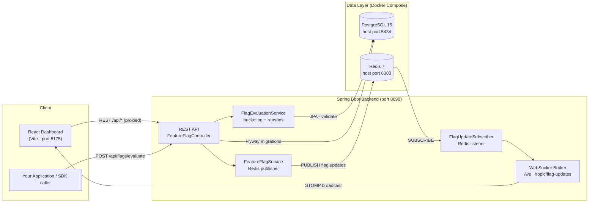

# Feature Flag Management Service

> A LaunchDarkly-style feature flag service with real-time updates — toggle a flag in the dashboard and every connected client updates instantly via Redis pub/sub → WebSocket, with consistent percentage rollouts and full evaluation logging.


Built by [Lakshman Sai Yaganti](https://github.com/LakshmanYaganti) — Data Scientist at Square. This project demonstrates production patterns for safe, gradual feature releases: kill switches, targeted rollouts, and environment-specific controls without redeploying code.

---

## Features

- **Consistent bucketing** — `hash(flagKey + userId) % 100` ensures the same user always gets the same result for a given flag, while each flag buckets independently.
- **Percentage rollouts** — gradually expose a feature to 1% → 25% → 50% → 100% of users and roll back instantly if something breaks.
- **Targeted users** — specific user IDs (beta testers, VIPs, QA accounts) always receive the flag regardless of rollout percentage.
- **Environment targeting** — per-flag on/off for `production` / `staging` / `development`, so a feature can be live in staging while dark in production.
- **Real-time updates** — flag changes publish to a Redis channel (`flag.updates`); a subscriber broadcasts over WebSocket (STOMP / SockJS) so all open dashboards update in under ~100 ms with no refresh.
- **Evaluation logging** — every SDK evaluation is logged to PostgreSQL with its reason code, powering usage stats and audit history.
- **SDK-style evaluation endpoint** — `POST /api/flags/evaluate` is the drop-in endpoint any application calls to ask "is this feature ON for this user?"
- **Seeded demo data** — Flyway migrates the schema and seeds 4 sample flags on first startup (see Demo Walkthrough).

## Architecture



**How a toggle propagates:** Dashboard toggles a flag → Spring Boot persists it to PostgreSQL → publishes to the Redis `flag.updates` channel → `FlagUpdateSubscriber` receives it → broadcasts over WebSocket → every connected dashboard updates instantly.

## Tech Stack

| Layer | Technology | Version / Notes |
|-------|------------|-----------------|
| Backend language | Java | 17 |
| Backend framework | Spring Boot | 3.2.3 (Web, Data JPA, Data Redis, WebSocket, Validation) |
| Database | PostgreSQL | 15 (Alpine) via Docker Compose |
| Migrations & seed data | Flyway | `flyway-core` + `flyway-database-postgresql` 10.4.1 — `V1__init.sql` |
| Cache / messaging | Redis | 7 (Alpine) — pub/sub channel `flag.updates` |
| Real-time transport | WebSocket | STOMP over SockJS (`@stomp/stompjs`, `sockjs-client`) |
| Frontend | React | 18.2.0 |
| Frontend build tool | Vite | 5.1.3 (`@vitejs/plugin-react` 4.2.1) |
| Frontend styling | Tailwind CSS | 3.4.1 (+ PostCSS / Autoprefixer) |
| Frontend HTTP / UI | Axios, Lucide React, React Hot Toast | 1.6.7 / 0.344.0 / 2.4.1 |
| Utilities | Lombok, Jackson | Compile-time boilerplate reduction, JSON handling |
| Infrastructure | Docker Compose | PostgreSQL + Redis containers |

Versions above are taken directly from `backend/pom.xml` and `frontend/package.json`.

## Project Structure

```
Feature_Flags/
├── docker-compose.yml          # PostgreSQL (5434) + Redis (6380)
├── HOW_TO_RUN.md               # Detailed step-by-step run guide
├── README.md
├── LICENSE
├── backend/                    # Spring Boot service (port 8090)
│   ├── pom.xml
│   └── src/main/
│       ├── java/com/flags/
│       │   ├── FeatureFlagApplication.java
│       │   ├── config/         # CORS, Redis, WebSocket configuration
│       │   ├── controller/     # FeatureFlagController (REST API)
│       │   ├── dto/            # Evaluate / Flag request & response types
│       │   ├── model/          # FeatureFlag, FlagEvaluationLog entities
│       │   ├── repository/     # Spring Data JPA repositories
│       │   └── service/        # Flag CRUD, evaluation/bucketing, Redis subscriber
│       └── resources/
│           ├── application.yml
│           └── db/migration/V1__init.sql   # Schema + 4 seeded flags
└── frontend/                   # React dashboard (port 5175)
    ├── package.json
    ├── vite.config.js          # Dev server + /api and /ws proxies
    └── src/
        ├── App.jsx
        ├── components/         # FlagCard, CreateFlagModal, EvaluatePanel
        ├── hooks/useWebSocket.js
        └── services/api.js
```

## Quick Start

### Prerequisites

| Tool | Version |
|------|---------|
| Java (JDK) | 17+ |
| Maven | 3.8+ |
| Node.js | 18+ |
| Docker | Running (Docker Desktop or Engine + Compose) |

### Run it

```bash
# 1. Clone
git clone https://github.com/LakshmanYaganti/Feature_Flags.git
cd Feature_Flags

# 2. Start PostgreSQL + Redis
docker-compose up -d

# 3. Start the backend (terminal 2)
cd backend
mvn spring-boot:run

# 4. Start the frontend (terminal 3)
cd frontend
npm install
npm run dev
```

Open **http://localhost:5175**.

On first startup Flyway creates the `feature_flags` and `flag_evaluation_logs` tables and seeds 4 sample flags. See [HOW_TO_RUN.md](HOW_TO_RUN.md) for the full step-by-step guide, troubleshooting, and demo script.

### Ports

| Service | Host port | Notes |
|---------|-----------|-------|
| Frontend (Vite) | 5175 | Dashboard UI |
| Backend (Spring Boot) | 8090 | REST API + WebSocket |
| PostgreSQL | 5434 | Mapped from container 5432 (see `docker-compose.yml`) |
| Redis | 6380 | Mapped from container 6379 |

The non-default database/cache ports let this project run side-by-side with other local services without conflicts.

### Stop

```bash
# Ctrl+C in the backend and frontend terminals, then:
docker-compose down
```

## API

Base URL: `http://localhost:8090`

| Method | Endpoint | Description |
|--------|----------|-------------|
| GET | `/api/flags` | List all flags |
| POST | `/api/flags` | Create flag |
| PUT | `/api/flags/{id}` | Update flag |
| PATCH | `/api/flags/{id}/toggle` | Toggle on/off |
| POST | `/api/flags/evaluate` | Evaluate flag for a user |
| GET | `/api/flags/{key}/logs` | Evaluation history |
| GET | `/api/stats` | Aggregate evaluation stats |

### Evaluate example

```http
POST http://localhost:8090/api/flags/evaluate
Content-Type: application/json

{
  "flagKey": "new-checkout-flow",
  "userId": "user-abc",
  "environment": "production"
}
```

```json
{
  "flagKey": "new-checkout-flow",
  "enabled": true,
  "reason": "PERCENTAGE_ROLLOUT",
  "userId": "user-abc",
  "environment": "production"
}
```

## Evaluation Reasons

Every evaluation returns a reason code explaining *why* the flag resolved the way it did. Reasons are checked in priority order:

| Reason | Meaning |
|--------|---------|
| `TARGETED_USER` | userId in the targeted list → always true |
| `FULL_ROLLOUT` | rolloutPercentage = 100 |
| `PERCENTAGE_ROLLOUT` | hash bucket < rollout % |
| `FLAG_DISABLED` | Global enabled = false |
| `ENV_DISABLED` | Disabled for this environment |
| `ZERO_ROLLOUT` | rolloutPercentage = 0 |
| `FLAG_NOT_FOUND` | Flag key doesn't exist |

## Demo Walkthrough

The database is seeded with 4 flags: `new-checkout-flow` (50% rollout, targeted VIP users), `dark-mode` (100% rollout), `ai-recommendations` (globally off), and `beta-dashboard` (10% rollout, targeted beta user).

1. **Real-time sync** — Open http://localhost:5175 in two browser tabs. Toggle any flag in one tab and watch the other tab update instantly — Redis pub/sub → WebSocket in action. The "Live Events (Redis → WS)" panel shows each toggle as it arrives.
2. **Targeted user** — In the **SDK Evaluator** panel, select `new-checkout-flow` with user ID `user-vip-001` → **ENABLED** (`TARGETED_USER`).
3. **Percentage bucketing** — Keep `new-checkout-flow` and try `user-random-999` → the result depends on that user's hash bucket at 50% rollout. Re-evaluate with the same user ID: the result never changes — bucketing is consistent.
4. **Beta flag** — Try `beta-dashboard` with `user-beta-001` → always **ENABLED** (targeted).
5. **Kill switch** — Try `ai-recommendations` with any user → always **DISABLED** (`FLAG_DISABLED`).
6. **Create your own flag** — Click "New Flag", use key `my-new-feature` (lowercase, hyphens only), set rollout to 25%, save, then test it in the SDK Evaluator with different user IDs.

**Key files to understand the system:**

- `FlagEvaluationService.java` — the bucketing algorithm and evaluation waterfall
- `FeatureFlagService.java` — Redis pub/sub publish on every flag change
- `FlagUpdateSubscriber.java` — Redis listener that forwards updates to WebSocket
- `FlagCard.jsx` — the toggle UI component

## License

MIT — see [LICENSE](LICENSE).

## Author

**Lakshman Sai Yaganti** — Data Scientist at Square · Arizona, USA

- GitHub: https://github.com/LakshmanYaganti
- LinkedIn: https://www.linkedin.com/in/y-lakshman/
- Portfolio: https://lakshmanyagantiportfolio.lovable.app/
- Email: lakshmanyaganti47@gmail.com
